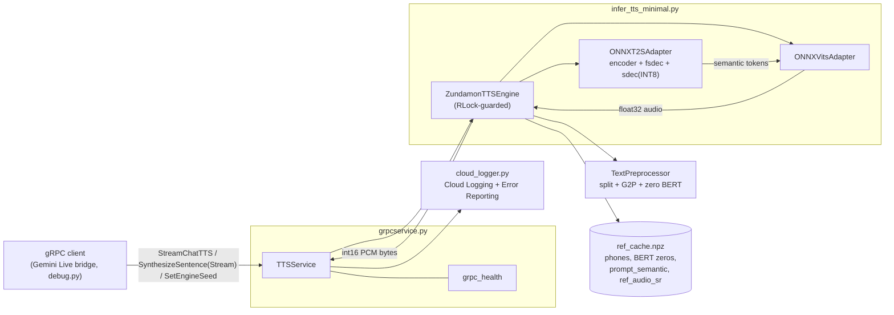
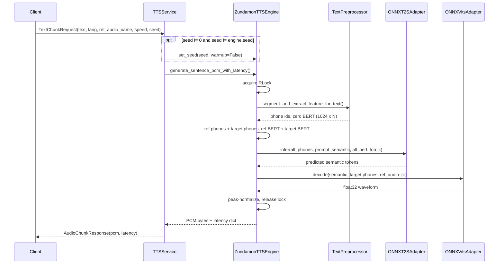
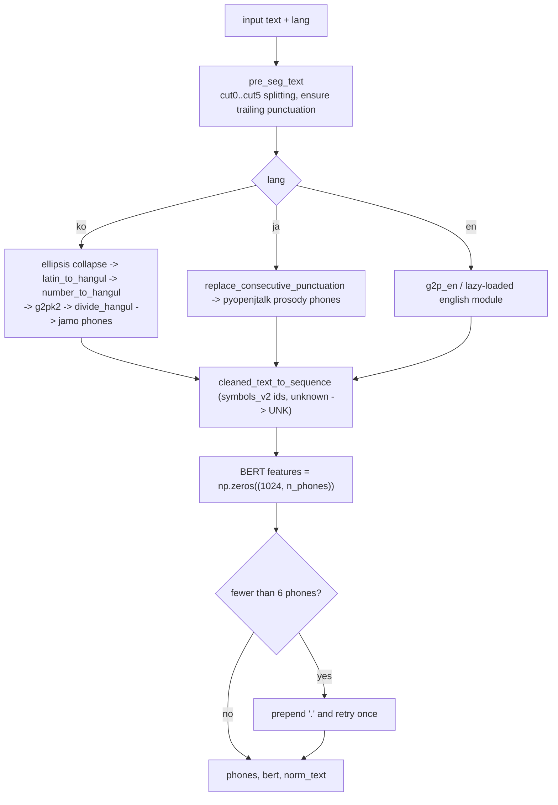
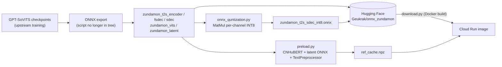

# AGENTS.md — Voiceger for Cloud

Rules and context for AI coding agents working in this repository.
Read this file fully before changing code.

## 1. What this project is

A **CPU-only, torch-free inference server** for the Zundamon voice (GPT-SoVITS v2 fine-tune).
It is a fork of voiceger-v2 whose goal is to remove overhead and maximize TTS speed on CPU
(primary target: Google Cloud Run Gen2, Intel Xeon / AMD EPYC).

- Languages synthesized: **Korean (`ko`), Japanese (`ja`), English (`en`)**. Chinese is **not** supported at runtime.
- Serving: gRPC (`grpcservice.py`), PCM 16-bit mono @ 32 kHz.
- Entry points: `python grpcservice.py` (server) and `python infer_tts_minimal.py` (local smoke test, writes `zundamon_hybrid_final.wav`).
- Models are hosted on Hugging Face (`Geukrak/onnx_zundamon`) and fetched by `download.py`.

## 2. Repository layout

| Path | Role | Shipped in Docker image? |
| --- | --- | --- |
| `infer_tts_minimal.py` | **Core engine.** `ZundamonTTSEngine`, ONNX adapters, provider selection, seed handling | Yes |
| `grpcservice.py` | gRPC server (`TTSService`), health check, warm-up | Yes |
| `cloud_logger.py` | Cloud Logging + Error Reporting with local console fallback | Yes |
| `protos/tts.proto` | gRPC contract (source of truth) | Yes |
| `tts_pb2.py`, `tts_pb2_grpc.py` | Generated stubs, **committed at repo root** | Yes |
| `TTS_infer_pack/TextPreprocessor.py` | Text splitting, G2P (ko/ja/en), number normalization | Yes |
| `text/` | `symbols2.py`, English dict caches, `ja_userdic/` | Yes |
| `GPT_weights_v2/`, `SoVITS_weights_v2/` | ONNX weights (git-ignored, downloaded) | Downloaded at build time |
| `reference_audios/` | 8 emotion reference wavs + prebuilt `ref_cache.npz` | Yes |
| `download.py` | Fetches ONNX weights from Hugging Face | Yes (build step) |
| `preload.py` | **Offline** builder of `ref_cache.npz` (needs torch + CNHuBERT) | No |
| `onnx_quntization.py` | **Offline** INT8 dynamic quantization of the `sdec` model (filename typo is intentional history; do not rename without updating references) | No |
| `debug.py` | gRPC client for manual testing against `localhost:50051` | No |
| `GPT_SoVITS/`, `tools/`, `feature_extractor/` | Legacy upstream code, only used by offline scripts | No (`GPT_SoVITS/` is dockerignored) |
| `benchmark.py` | Currently empty placeholder | No |

> `TTS.py` (legacy PyTorch pipeline) and `onnx_export.py` no longer exist in the working tree.
> Some comments, docs and `.dockerignore` still mention them. Do not try to restore them.

## 3. Architecture



### 3.1 Synthesis pipeline (per sentence)



### 3.2 Text frontend



### 3.3 Offline asset pipeline (not run in production)



## 4. Dependencies

Two requirement files with a strict split:

- `requirements.txt` — **runtime only. No torch, no transformers.** Installed in the Docker image.
  - Inference: `numpy`, `onnxruntime-openvino`, `openvino`
  - Audio: `soundfile`, `soxr`
  - G2P: `LangSegment`, `py3langid`, `pyopenjtalk` (needs CMake to build), `jamo`, `ko-pron`, `g2pk2`, `python-mecab-ko` (+ `-dic`), `eunjeon` (Windows only), `nltk`, `g2p-en`, `wordsegment`
  - Serving: `grpcio`, `grpcio-health-checking`, `protobuf`, `fastapi`
  - Observability: `google-cloud-logging`, `google-cloud-error-reporting`
- `requirements-dev.txt` — adds `torch` (CPU), `transformers`, `librosa`, `onnx`, `pytorch-lightning`, `snakeviz`, etc. Only for `preload.py`, quantization and profiling.

Rules:

- **Never** add `torch`, `transformers`, `librosa`, `scipy` or other heavy packages to `requirements.txt`.
- Keep both requirement files **ASCII-only** (pip on Windows decodes with the locale codec).
- Only direct dependencies are pinned; let pip resolve transitive ones.
- Regenerating stubs: `python -m grpc_tools.protoc -Iprotos --python_out=. --grpc_python_out=. protos/tts.proto`
  (use `-Iprotos`, **not** `-I.`; otherwise stubs are written under `protos/` and the server imports the stale root copies). Delete any stray `protos/tts_pb2*.py`.

## 5. Hard invariants (do not break)

1. **No PyTorch at runtime.** `infer_tts_minimal.py` main() prints whether `torch` is in `sys.modules`; it must be `False`. `TextPreprocessor.py` must stay pure NumPy.
2. **BERT is always zeros** for `ko`/`ja`/`en`. `chinese-roberta-wwm-ext-large` was only ever used for Chinese upstream; ko/ja already used zero tensors in the original WebUI path, so the RoBERTa path was removed on purpose. Shape is `(1024, n_phones)`, float32. `ref_cache.npz` stores matching `(1024, 56)` zeros for the reference prompt.
3. **No network access at runtime.** The image sets `HF_HUB_OFFLINE=1` and `TRANSFORMERS_OFFLINE=1`. NLTK data, the pyopenjtalk dictionary and ONNX weights are baked in at build time.
4. **No file named `logging.py` anywhere in the repo root** (shadows the stdlib and breaks `cloud_logger.py`; a stale `logging.cpython-311.pyc` exists in `__pycache__`, ignore it).
5. **Do not filter `~` (tilde) in `TextPreprocessor.py`.** Tilde and emoji removal is done by the upstream service that sends text to this server.
6. **Reference prompt ends with a sentence-final token.** Do not "clean up" the `ref_cache.npz` phones.
7. **Console output is UTF-8.** Entry scripts call `sys.stdout.reconfigure(encoding="utf-8")` for Windows cp949 consoles. Keep that at the top of new entry scripts.

## 6. Implementation notes and gotchas

### 6.1 Text frontend (Korean)

- `number_to_hangul()` **must run before** `g2pk2`. g2pk2 only handles bound nouns (`NNBC`) and reads numerals digit-by-digit (`14만` -> `일사만`). Our pre-normalization produces `십사만` so g2pk2 then applies tensification (`[십싸만]`).
  - Handles: phone numbers (`010-1234-5678`), decimals, percentages, hours (`시`: 1–12 pure Korean, 13+ Sino-Korean), classifier counters (`개`, `명`, `마리`, ...), standalone integers.
  - Use digit lookarounds `(?<!\d)...(?!\d)` instead of `\b`: Hangul counts as `\w`, so `\b` fails between `8` and `로`.
  - Check `시` **before** the generic pure-Korean classifier set.
- Collapse `..+` / `…+` into a single `…` **before** G2P. `_ko_post_replace_ph` is applied per character, so a multi-character key like `"..."` never matches.
- A leading `。` is intentionally prepended in `pre_seg_text` for short first words (`len(get_first(text)) < 4`). Empirically it **improves** stability of the first syllable. Do not remove it. Consecutive dots, however, trap the first syllable between sentence-final tokens and lower the opening pitch, so keep the ellipsis collapse.
- `g2pk2` uses Mecab (`python-mecab-ko` on Linux, `eunjeon` on Windows).

### 6.2 Engine and ONNX

- The `sdec` model is a **stepwise KV-cache decoder** driven with `io_binding` and ping-pong bindings. Do not "simplify" it into per-step `session.run` with host copies; that destroys latency.
- Provider selection (`get_onnx_providers`): Intel + OpenVINO EP -> `OpenVINOExecutionProvider` (device `CPU`), otherwise `CPUExecutionProvider`. On Windows the OpenVINO `libs` dir is added to `PATH`/DLL search path.
- Thread count comes from `OMP_NUM_THREADS` / `ORT_INTRA_OP_NUM_THREADS`, then cgroup v2/v1 quota, then `os.cpu_count()`.
- INT8 quantization of `sdec` is **off by default**. Set the system environment variable `enable_quantization` (or `ENABLE_QUANTIZATION`) to `1`/`true`/`yes`/`on` to use `zundamon_t2s_sdec_int8.onnx`; if that file is missing the engine falls back to FP32 with a warning. An explicit `gpt_sdec_path` argument overrides the variable. It is read with `os.environ` only (no `python-dotenv`, no `.env` loading). Known issue: INT8 can degrade audio on some inputs (e.g. `~`), which is why it is opt-in.
- The first inference triggers OpenVINO graph compilation (seconds). Always `warmup()` before serving. `grpcservice.serve()` does this.
- Reference audio entries are keyed by full filename **and** stem (`01_ref_emoNormal026.wav` / `01_ref_emoNormal026`). Switching emotion via `set_ref_audio()` is cheap (dict lookup), no model reload.
- Output is peak-normalized only when `max(|audio|) > 1.0`.

### 6.3 Seed handling and determinism

- Randomness lives **inside the ONNX graphs** (`RandomNormalLike` in `sdec` for sampling and in the VITS decoder for noise). Python/NumPy seeds alone do not affect it.
- `ort.set_seed()` only takes effect for **sessions created after the call**. Changing the seed therefore requires rebuilding the sessions: `ZundamonTTSEngine.set_seed()` deletes the adapters, calls `gc.collect()`, reseeds, recreates the sessions, rebinds the reference audio, and optionally warms up. This takes tens of seconds with OpenVINO (~57 s observed locally).
- Same seed does **not** guarantee identical audio: the RNG state advances with every sentence, and multi-threaded float reductions plus provider/quantization differences perturb sampling. Treat seeds as a tone/prosody control, not a bit-exact guarantee.
- `seed=None` / `-1` / `""` picks a random seed; the chosen value is always printed (`🎲 [시드 설정] ...`). Preserve that log line.
- `ZundamonTTSEngine.lock` is an **`RLock`** on purpose: `set_seed()` holds it while calling `warmup()` -> `generate_sentence_with_latency()`. Switching to `Lock` deadlocks the `SetEngineSeed` RPC.
- `TextChunkRequest.seed == 0` means "keep current seed". Per-request seed changes in the synthesis RPCs use `warmup=False`.

### 6.4 gRPC / Cloud Run

- Services: `StreamChatTTS` (bidi; a producer thread buffers requests into a `queue.Queue`, the handler thread synthesizes sequentially), `SynthesizeSentenceStream` (2048-byte PCM chunks), `SynthesizeSentence` (unary), `SetEngineSeed`.
- Cloud Run throttles CPU when no request is in flight. **Never reload models or warm up in a background thread.** Do heavy work synchronously inside the request handler (this is why `SetEngineSeed` blocks until reload and warm-up finish). Whether a reload fits inside the request timeout on the target instance size still needs to be tested.
- When reloading, free the old sessions first (`del` + `gc.collect()`) before creating new ones, otherwise old and new sessions coexist and can exceed the memory limit.
- The server listens on `$PORT` (default `50051` locally, `8080` in the image) and registers `grpc_health` if available.
- `ThreadPoolExecutor(max_workers=8)`: all synthesis calls serialize on the engine `RLock`, so extra workers only help I/O.
- Error Reporting is driven by `logger.error(..., exc_info=True)` / `logger.exception(...)` via `cloud_logger.GCPErrorReportingLoggingHandler`. Use `report_exception()` for manual reporting. Locally it falls back to a colored console logger.

### 6.5 Protobuf

- Edit `protos/tts.proto`, then regenerate stubs (see section 4). Only add fields with new, unused numbers; never renumber existing ones.
- Current additions: `SetSeedRequest/SetSeedResponse`, `TextChunkRequest.seed = 7`.

## 7. Common commands

```bash
# Setup (runtime)
pip install -r requirements.txt
python download.py                      # fetch ONNX weights from Hugging Face

# Setup (offline tooling)
pip install --extra-index-url https://download.pytorch.org/whl/cpu -r requirements-dev.txt

# Run
python infer_tts_minimal.py             # local synthesis -> zundamon_hybrid_final.wav
python grpcservice.py                   # gRPC server on $PORT (default 50051)
python debug.py                         # sample gRPC client (server must be running)

# Offline asset generation
python preload.py                       # rebuild reference_audios/ref_cache.npz
python onnx_quntization.py              # produce zundamon_t2s_sdec_int8.onnx

# Docker
docker build -t voiceger-app:test .
docker run --rm --entrypoint python voiceger-app:test infer_tts_minimal.py   # same as CI
```

## 8. Testing and verification

- CI (`.github/workflows/dockerbuild.yml`) builds the image and runs `infer_tts_minimal.py` inside it. A change is only "green" if the container build and that smoke test pass.
- There is no unit test suite. When changing the text frontend, verify phoneme output directly, for example:

  ```python
  from TTS_infer_pack.TextPreprocessor import TextPreprocessor
  tp = TextPreprocessor()
  phones, bert, norm = tp.segment_and_extract_feature_for_text("조회수가 14만 돌파했어!", "ko", "v2")
  ```

  and listen to the generated wav. Never judge audio changes from phoneme dumps alone.
- Synthesis is slow on CPU (about 3–8 `sdec` steps/s locally). Run long commands as background tasks and avoid polling in tight loops.

## 9. Conventions for agents

- Respond to the maintainer in **Korean**; keep this file and code identifiers in **English**. Existing Korean log messages and comments are intentional; preserve them unless the change touches them.
- Preserve unrelated comments and docstrings.
- Keep changes minimal and local. Do not introduce new heavy dependencies, new frameworks, or a web UI (the WebUI was deliberately removed).
- Do not commit generated media (`*.wav`, `*.prof`); `.gitignore` allows only `reference_audios/*.wav`.
- Large model files are **not** in git; never add them. `GPT_weights_v2/`, `SoVITS_weights_v2/` and `reference_audios/` contain `.gitignore` files that govern this.
- When you add a new runtime-only script, make sure it is neither listed in `.dockerignore` by mistake nor imports anything from `requirements-dev.txt`.
- Be honest about unverified claims, especially performance and determinism: measure on the OpenVINO path, not only on plain CPU.

## 10. Known open items

- Verify that `SetEngineSeed` (reload + warm-up) completes within Cloud Run request timeouts and without CPU throttling issues on the chosen instance size; consider `--no-cpu-throttling` if not.
- `preload.py` expects `SoVITS_weights_v2/zundamon_latent.onnx`, which `download.py` does not fetch.
- `Dockerfile` header still says the ONNX pipeline is incomplete, and `docker-compose.yml` / README files reference outdated details (`requirements_final.txt`, WebUI).
- `benchmark.py` is empty.
